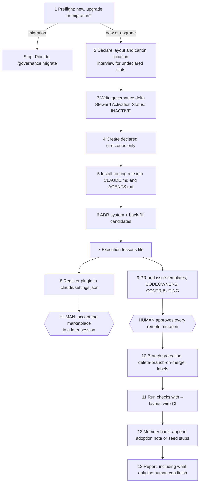
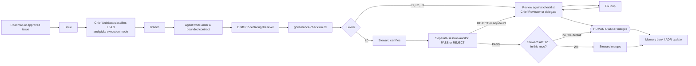

# How agentic-governance works

Status: Draft
Last updated: 2026-11-09
Owner: Project owner
Describes: agentic-governance v0.9.1 (`VERSION`), plus the open G-3 slice in PR #31 where noted

> **This is a derived view.** It explains the canon; it does not add to it.
> Every rule below is stated, with its authority, in the `llm/` documents
> listed under [Sources](#sources). Where this page and those documents
> disagree, they win and this page is the defect.

## 1. The short version

agentic-governance is a set of rules, a per-repo contract and a small
toolkit that together decide how work moves through a repository when AI
agents do most of the typing. It has three layers.

1. **Canon.** Project-agnostic policy in `llm/governance/` and
   `llm/constitution/`: how work is classified, who may review and merge
   it, where documents live, how decisions are recorded.
2. **Delta.** One file per adopting repo,
   `llm/governance/governance-delta.md`, that binds the canon to that
   repo's facts: its paths, its check command, what its platform actually
   enforces, and whether the AI merge lane is switched on.
3. **Execution.** A Claude Code plugin (`plugin/`) with four role agents,
   three skills (`establish`, `audit`, `migrate`) and one deterministic
   check script, `governance-checks.mjs`.

The whole design rests on one idea. Human review is expensive, so spend it
only on changes that alter meaning. Everything mechanical is certified,
audited and logged instead of silently trusted.

## 2. The parts

| Part | Where | What it does | Runs as |
|---|---|---|---|
| Governance levels | `llm/governance/governance-levels.md` | Classifies every change as L0 (administrative) or L1/L2/L3 (semantic) and fixes who may merge it | Policy |
| L0 fast track | `llm/governance/l0-fast-track.md` | The only lane where an AI may merge: twelve conditions, a certification block, a path allowlist | Policy + checker `--l0` |
| Architecture governance | `llm/governance/architecture-governance.md` | Authority hierarchy, no-orphan-decisions rule, ADR process, roles, PR lifecycle | Policy |
| Operating system | `llm/governance/project-operating-system.md` | Work-item lifecycle, execution modes 1 to 3, agent contracts, quality gates, the two-plane layout | Policy |
| Definition of done / review checklist | `llm/governance/definition-of-done.md`, `review-checklist.md` | Completion and review criteria per level | Checklists used by humans and agents |
| Constitution | `llm/constitution/shared-principles.md` | Twelve shared principles; the single-exception merge rule | Policy |
| Chief Architect | `plugin/agents/chief-architect.md` | Classifies work, picks execution mode, delegates, owns design content | Agent persona |
| Chief Reviewer / Governance Auditor | `plugin/agents/chief-reviewer.md` | Reviews L1 to L3 PRs; independently audits L0 certifications | Agent persona |
| Chief Product Officer | `plugin/agents/chief-product-officer.md` | MVP discipline and user value | Agent persona |
| Repository Steward | `plugin/agents/repository-steward.md` | L0 bookkeeping; certifies and (only if activated) merges L0 PRs | Agent persona |
| `establish` | `plugin/skills/establish/SKILL.md` | Onboards a repo: layout, delta, routing rule, ADRs, templates, labels, protection, CI | Skill |
| `audit` | `plugin/skills/audit/SKILL.md` | Twelve compliance checks; reports, never fixes | Skill |
| `migrate` | `plugin/skills/migrate/SKILL.md` | Moves a pre-v0.3 repo to the two-plane layout with history preserved | Skill |
| `governance-checks.mjs` | `plugin/scripts/` | Six deterministic checks, no LLM involved | Node script, locally and in CI |

## 3. Adopting a repository

Adoption is a skill run, `/governance:establish`, not a copy of files. It
works through thirteen steps. The ones that need a person are marked.



Three things about adoption matter for everything that follows.

- **It never switches on the AI merge lane.** The delta it writes always
  says `Steward Activation Status: INACTIVE`.
- **It asks before touching GitHub.** Repo creation, branch protection and
  labels each need the owner's approval.
- **It cannot finish the plugin install.** Claude Code requires a person to
  accept a newly declared marketplace. The skill writes the registration and
  reports the acceptance as a human follow-up.

## 4. The life of a change

Every change follows one path. Execution mode changes how the work is
produced, never which path it takes.



### 4.1 Classification decides everything

A change is **semantic** if a reasonable reviewer could believe it alters
meaning, behavior, decisions or obligations. It is **non-semantic** only
if an auditor can confirm, from the diff and merged state alone, that
nothing meant, decided or promised has changed. The burden of proof sits on
non-semantic.

| Level | Covers | Who reviews | Who merges |
|---|---|---|---|
| L0 Administrative | Exactly fourteen bookkeeping categories (memory-bank sync to merged work, ADR status flips citing the approving PR, index regeneration, link path fixes, typo fixes outside normative text, branch cleanup, and so on) | Steward certifies; an independent auditor audits | The human owner, unless the repo has activated the steward |
| L1 Governance and architecture | ADR content, design authority, governance policy, the delta | Human | Human only |
| L2 Implementation | Code, schemas, CI behavior, executable config, security controls | Human | Human only |
| L3 Product | Requirements, scope, business rules, privacy policy | Human | Human only |

Three rules keep classification honest.

- **Conservative default.** Unsure means semantic, which means human review.
- **Highest level wins.** One L1 sentence makes an otherwise
  administrative PR L1.
- **Escalation runs one way for AI.** Any participant may move a change up.
  Only the human owner may move it down, and only by explicit statement on
  the PR or issue.

### 4.2 The semantic lane

For L1 to L3 work the PR lifecycle is
`Task → Branch → Draft PR → Review → Fix loop → Approval → Merge`. The
author (human or agent) opens the draft PR; a change that is not yet a PR
cannot be reviewed. The reviewer applies the review checklist and the
delta's domain questions. Only the human owner merges, and the owner does
not open PRs on the author's behalf.

### 4.3 The L0 lane

The L0 lane exists to stop spending human attention on bookkeeping. It is
deliberately narrow and it ships switched off.

```mermaid
sequenceDiagram
    participant St as Repository Steward
    participant CK as governance-checks --l0
    participant Au as Governance Auditor (separate session)
    participant H as Human owner
    St->>St: Classify. Any judgment about meaning? Escalate and stop.
    St->>St: Open admin/<topic> PR titled "L0: ..." with certification
    St->>CK: Run with allowlist read from origin/main
    CK-->>St: PASS/FAIL per path and diff shape
    St->>Au: Request independent audit
    Au-->>St: PASS or REJECT as a PR comment
    alt REJECT, any flag, or check failure
        St->>H: Leaves the fast track, normal human review
    else PASS and repo is INACTIVE (default)
        St->>H: Human merges; artifacts speed the review
    else PASS and repo is ACTIVE
        St->>St: Merge, delete branch, record actions on the PR
    end
```

Activation needs two things the owner produces: a repo-local ADR granting
the steward merge authority, and a human-approved, human-merged PR flipping
the delta to `ACTIVE`. Deactivation needs only a human statement and a
delta flip. Canon itself has not activated it, and its delta records why:
every agent session uses the owner's token, so the platform cannot tell a
steward merge from an owner merge. (Adopters' status is checked by the
census in the standards study, not assumed here.)

## 5. How agents are run

Before substantial work the Chief Architect picks one of three execution
modes and records it in the issue or PR.

| Mode | Shape | Typical use |
|---|---|---|
| 1 Single agent | One agent, one contract, one branch | Narrow fixes, small edits, routine L0 |
| 2 Specialist team | Parallel agents on disjoint files, then reconciliation | Cross-document design, multi-expertise research |
| 3 Ultracode | Dependency-aware waves of agents, independent governance audit, Lead Architect reconciliation | Multi-repo, repo-wide or audit/reconcile-heavy work |

Every agent receives a bounded contract with fourteen fields (role,
objective, required reading, allowed and forbidden files, deliverables,
definition of done, scope boundary, git rules, report shape and others).
Every deliverable reports assumptions, alternatives, risks, open questions
and ADR candidates. Mode is an execution choice only. Work produced by ten
agents in Mode 3 needs exactly the review it would need from one.

## 6. Where documents go

The repository has two planes, split by what a document **does**, not by
who wrote it.

- **Control plane, `llm/`.** Anything that governs, plans, records,
  reviews or operates the repo: policy, the delta, ADRs, specs, plans,
  backlog, memory bank, retrospectives.
- **Data plane, `docs/`.** Deliverables, external material and derived
  views. A derived view must name the `llm/` document it projects, as this
  page does.

Before creating a document an agent answers Q1 (does it govern how the repo
is run?) then Q2 (is it a deliverable or reference?). If Q1 is unclear, it
is control plane. The rule is installed into each repo's `CLAUDE.md` and
`AGENTS.md` because tools such as Superpowers otherwise write specs into
`docs/superpowers/` by default. ADR-0001 records that history.

## 7. Decisions and memory

- **No orphan decisions.** A decision that exists only in chat, including
  any AI chat, is not authoritative. It must land in an ADR, the
  design-authority document, a design doc, the memory bank, or an issue or
  PR note before anyone acts on it.
- **Authority hierarchy.** When artifacts conflict: memory bank, then the
  design-authority document, ADRs, detailed design, issues, PRs, and code
  last. Code that contradicts an approved ADR is wrong until the ADR
  changes.
- **Memory bank.** The context source for AI sessions. Syncing it to merged
  work is L0. Recording a new direction in it is semantic and travels with
  the PR that makes the decision.

## 8. What is checked, and by what

There are four kinds of enforcement. They are not equally strong.

| Tier | Mechanism | What it covers |
|---|---|---|
| Platform | GitHub branch protection and required status checks, set by `establish` step 10 where the plan allows | PRs required on `main`; no force push or deletion; conversation resolution; the governance-check job blocks merge (only where it is a *required* check, see backlog G-2) |
| Deterministic | `governance-checks.mjs` | `governance-links` (every relative `.md` link resolves); `adr-index` (index matches ADR files and statuses); `adr-status` (valid status; a status flip changes only the status line); `layout` (declared paths exist, no source-of-truth files under `docs/`); `l0-paths` (every changed path allowlisted and diff shape respected, allowlist read from `origin/main`); `cert-present` (certification block and seven checked declarations) |
| Agent procedure | `audit` skill, steward and auditor charters | Twelve audit checks (version drift, ADR health and orphan-decision scan, direct commits to `main`, one level label per PR, allowlist syntax, steward status consistency, CI actually running the checks, GitHub surface, stale branches, memory-bank currency, control-plane files under `docs/`, documentation headers) |
| Convention | Everything else | Whether a change is truly meaning-preserving; whether the audit session was really independent; artifact ordering on the PR; the content quality of reviews |

The canon is unusually candid about the last row. The L0 policy carries an
"honest-gaps declaration", and each delta must record what its platform can
and cannot gate.

## 9. Every point where a human is required

This is the list a new collaborator usually asks for. Each row is a place
where the canon says an AI may not act alone.

| # | Moment | What the human does | Why an agent cannot | Source |
|---|---|---|---|---|
| H1 | Adoption | Approves each GitHub remote mutation (repo, protection, labels) | Changing someone's merge rules is not the agent's call | `establish` preamble, step 10 |
| H2 | Adoption | Accepts the new plugin marketplace in a later session | Claude Code has no non-interactive path | `establish` step 8 |
| H3 | Adoption | Supplies facts the repo cannot reveal: mission, principles, review questions | They are the project's intent | `establish` steps 2–3 |
| H4 | Any change | Resolves classification disputes; is the only one who may lower a level | Downgrading is how semantic work would leak into L0 | `governance-levels.md` §Escalation |
| H5 | L1–L3 | Merges, after an independent reviewer approves | Sole merge authority above L0 | `governance-levels.md` §Merge Authority |
| H6 | L0, steward inactive | Merges certified, audited L0 PRs | Default in every repo | `l0-fast-track.md` §Per-Repo Activation |
| H7 | Steward activation | Writes and merges the activation ADR and PR | Merge authority is earned per repo, not shipped | same |
| H8 | Steward deactivation | States it on an issue or PR and flips the delta | Revocation must be cheap and human | same |
| H9 | Escalations | Receives every steward escalation (eleven triggers) and every auditor REJECT | The lane's whole value is refusing when in doubt | `repository-steward.md` §Conservative Default |
| H10 | Layout | Decides any move between control and data plane, and any change to declared paths | Placement is a judgment about what a document *is* | `repository-steward.md` §Layout Escalations |
| H11 | Agent disagreement | Resolves conflicts the authority hierarchy cannot | Final decision maker | `architecture-governance.md`, `shared-principles.md` |
| H12 | Durable decisions | Approves or rejects ADRs and design-authority changes | L1 content | `architecture-governance.md` §ADR Process |
| H13 | Platform | Manages branch protection and chooses the hardening path (`enforce_admins`, required reviews) | Repository administration | each delta §Platform Enforcement Reality |
| H14 | Audit follow-up | Decides which audit findings to fix; deletes stale branches | `audit` reports, it never mutates | `audit` §Report, check 8 |
| H15 | Verification (G-3, in PR #31) | Records HUMAN VERIFIED on a claim after inspecting and re-running its evidence | No agent may mark its own work complete | `llm/specs/2026-09-18-human-verification-capability-design.md` |

## 10. What it does not do yet

The canon names three of its own gaps in `llm/features/BACKLOG.md`.

- **G-1:** it governs how many agents run, but not which model they run on.
- **G-2:** `establish` wires the check into CI but does not make it a
  required status check, so a red PR can still merge in adopting repos.
- **G-3:** it governs process, not outcome. An agent can still tick its own
  acceptance criterion. A first vertical slice is open as PR #31.

A fourth, structural gap is documented in
`llm/specs/2026-10-01-harness-independence-audit.md`: the canon is
portable, but the runtime is Claude Code specific.

How complete it is against established software engineering and AI
governance standards is the subject of the study in
`llm/specs/2026-11-09-standards-completeness-study-design.md`. A first,
single-coder pass is in `docs/research/standards-benchmark/`.

## Sources

Control-plane documents this page projects:

- `llm/governance/governance-levels.md`
- `llm/governance/l0-fast-track.md`
- `llm/governance/architecture-governance.md`
- `llm/governance/project-operating-system.md`
- `llm/governance/definition-of-done.md`
- `llm/governance/review-checklist.md`
- `llm/governance/branch-protection.md`
- `llm/governance/governance-delta.md`
- `llm/constitution/shared-principles.md`
- `llm/features/BACKLOG.md`
- `llm/specs/2026-09-18-human-verification-capability-design.md`
- `llm/specs/2026-10-01-harness-independence-audit.md`
- `llm/governance/adr/0001-llm-control-plane-docs-data-plane.md`

Executable sources (the procedure itself, not restated here):
`plugin/skills/establish/SKILL.md`, `plugin/skills/audit/SKILL.md`,
`plugin/skills/migrate/SKILL.md`, `plugin/agents/*.md`,
`plugin/scripts/governance-checks.mjs` and `plugin/scripts/README.md`.
